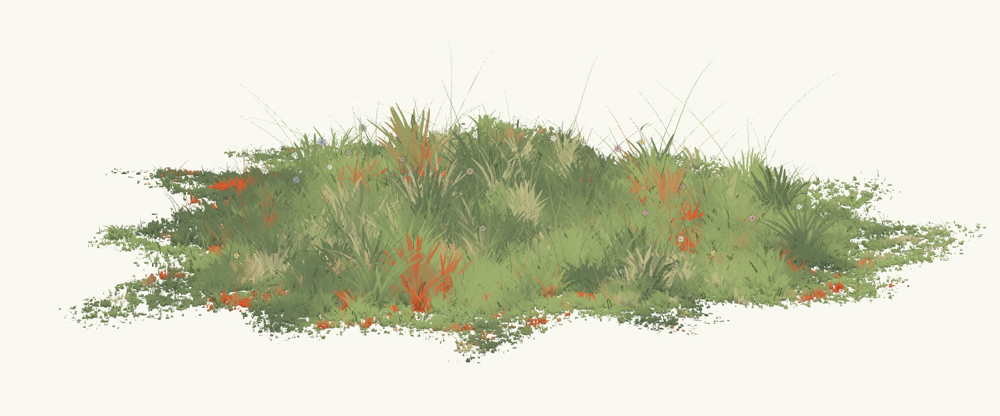
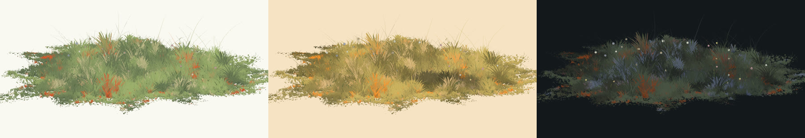

# Stylized grass



The painted meadow from [The Boring Blog](https://www.theboringblog.ai), as written up in "Making stylized grass". It's lifted out as plain ES modules on Three.js: no framework, no build step, nothing that knows about a page.

## Quick start

```bash
npm install
npm start   # http://127.0.0.1:4317 — drag to turn the meadow, keys 1–6 change the look
npm test
```

## What's here

| Path                      | What it is                                                                         |
| ------------------------- | ---------------------------------------------------------------------------------- |
| `src/mount.js`            | `mountField(host, opts)`: stand a meadow up in an element and get its handles back |
| `src/meadow/meadow.js`    | the ground, the blades, the specks, the flowers: geometry, shaders, uniforms       |
| `src/meadow/shade.js`     | the GLSL the rest is written in: noise, sun, shadow                                |
| `src/meadow/field.js`     | the ground baked to a texture, so a blade reads its colour and height in one fetch |
| `src/meadow/turntable.js` | an orthographic camera that only turns, in detents, by drag, wheel or key          |
| `src/meadow/dusk-sky.js`  | the day, dusk and night palettes; `arc.js` blends between them                     |
| `examples/index.html`     | the meadow, live                                                                   |
| `serve.mjs`               | a localhost static server, with Three.js mapped under `/vendor/`                   |

## Using it

```js
import { mountField } from "./src/mount.js";
import { SKY } from "./src/meadow/dusk-sky.js";

const host = document.querySelector("#field");
const field = mountField(host, { seed: 7, blades: 160000 });

field.rig.attach(host); // drag to turn
field.light(SKY.dusk); // repaint: colours, sun height, shadow
field.uniforms.uWind.value = 1.2; // blow harder
field.onFrame((dt, time) => {}); // run something every frame
field.dispose(); // when you are done with it
```

The modules import `"three"` by name, so a page needs an import map (see `examples/index.html`) or a bundler. Other options include `seed` (same number, same meadow), `blades`, `flowers`, `paper` (the clear colour) and `look` (`elevation`, `frustum`, `height`, `distance`); `mountField` documents each one. `field.uniforms` holds every knob the shaders read.

## Looks



A look is five colours (`grass`, `pale`, `deep`, `warm`, `cold`) plus the sun: `sunHeight`, `sunAmount`, `sunEdge`, `shadow` and `shadowSoft`. `SKY.day`, `SKY.dusk` and `SKY.night` are the blog's own sunset. Pass any of them, or your own, to `field.light()`. The example also carries the blog's season ring: February, May and October.

## How the grass works

- **One blade, many times.** Each blade is one instance of a narrow strip of vertices. It turns about its own vertical axis to face the camera, so it always reads as a stroke and never as an edge-on sliver. Per-instance attributes carry where it grows, its height, width, resting lean, phase and profile. The profile is an exponent that decides wispy or leafy.
- **Clumps, not scatter.** Blades are planted in clumps, mostly short wide puffs with taller wisps through them, at a density that thins towards the coast of a painted island.
- **The ground's colour, exactly.** The field is painted into a texture once (the "bake"), and each blade takes the colour at its root. A blade and the ground under it are the same number, so they read as one shape however far the variation goes.
- **Depth without lighting.** The lower part of every blade is mixed towards a shade colour. Down among ten thousand others is darker than the tips, and that one mix is most of what stops the field looking like a flat green mat.
- **Wind that travels.** One noise field is sampled at position minus direction times time, so a gust is a pattern sliding across the meadow rather than every blade waving on its own clock. A small fast flutter keeps the lulls from looking glassy, and lean plus wind is clamped so nothing folds past flat.
- **Growth.** `uGrow` sweeps past a per-blade `iDelay`, and each blade rises over a fixed band of it, so a meadow can sprout in whatever order its delays say.

## Provenance

The modules in `src/` are copied from the blog's source with only their import paths changed. Their comments still describe the site they came from (the home page, its `clearing.js`, the reading pages), and they are worth reading for the reasons behind the numbers.

No licence has been chosen for the code yet.
