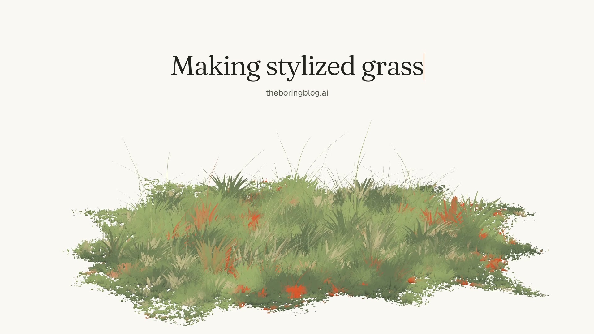

# Stylized grass

[](media/grass-film-720p.mp4)

The painted meadow from [The Boring Blog](https://www.theboringblog.ai)'s "Making stylized grass", lifted out as plain ES modules on Three.js. It comes with the pipeline that films it: a deterministic, beat-cut 34-second promo with a synthesized sound pass, rendered frame by frame from the real renderer. Click the still for a 720p preview with sound.

## Quick start

```bash
npm install
npm start      # http://127.0.0.1:4317 — the meadow, live; /film/ plays the film
npm test
```

Rendering the film also needs Playwright's Chromium and FFmpeg on your `PATH`:

```bash
npx playwright install chromium
npm run film          # film/out/grass-film.mp4 — 1920 × 1080, 60 fps, silent
npm run film:sfx      # film/out/grass-film-sfx.mp4 — the same picture, with sound
npm run film:preview  # a set of stills in film/out/previews/, no encode
npm run film:clean    # the film without its end card
```

`FILM_WIDTH` and `FILM_FPS` override the size and frame rate. `FILM_TIMES=0,6,22.5` chooses the preview stills. A full render takes about a minute and a half on an M4 Max. On macOS the renderer asks for ANGLE Metal, so the GPU does the work.

## What's here

| Path                      | What it is                                                                            |
| ------------------------- | ------------------------------------------------------------------------------------- |
| `src/mount.js`            | `mountField(host, opts)`: stand a meadow up in an element and get its handles back    |
| `src/meadow/meadow.js`    | the ground, the blades, the specks, the flowers: geometry, shaders, uniforms          |
| `src/meadow/shade.js`     | the GLSL the rest is written in: noise, sun, shadow                                   |
| `src/meadow/field.js`     | the ground baked to a texture, so a blade reads its colour and height in one fetch    |
| `src/meadow/turntable.js` | an orthographic camera that only turns, in detents, by drag, wheel or key             |
| `src/meadow/dusk-sky.js`  | the day, dusk and night palettes; `arc.js` blends them                                |
| `examples/index.html`     | the meadow, live: drag to turn it, keys 1–6 change the look                           |
| `film/timeline.js`        | the film's timing, shared by the picture and the sound                                |
| `film/film.js`            | the picture: growth, camera, palettes, wind, end card, all functions of film time     |
| `film/sfx.mjs`            | the sound: synthesized in Node from the same timeline, then muxed onto the render     |
| `film/render.mjs`         | seeks every frame in headless Chromium and pipes it to FFmpeg                         |
| `serve.mjs`               | a localhost static server for all of the above, with Three.js mapped under `/vendor/` |

## Using the meadow

```js
import { mountField } from "./src/mount.js";
import { SKY } from "./src/meadow/dusk-sky.js";

const host = document.querySelector("#field");
const field = mountField(host, { seed: 7, blades: 160000 });

field.rig.attach(host); // drag to turn
field.light(SKY.dusk); // repaint: colours, sun height, shadow
field.uniforms.uWind.value = 1.2; // blow harder
field.onFrame((dt, time) => {}); // run something every frame
field.dispose(); // when you are done with it
```

The modules import `"three"` by name, so the page needs an import map (see `examples/index.html`) or a bundler. Other options include `flowers`, `paper` (the clear colour) and `look` (`elevation`, `frustum`, `height`, `distance`); `mountField` documents each one. `field.uniforms` is every knob the shaders read.

## How the grass works

- **One blade, many times.** Each blade is one instance of a narrow strip of vertices. It turns about its own vertical axis to face the camera, so it always reads as a stroke and never as an edge-on sliver. Per-instance attributes carry where it grows, its height, width, resting lean, phase and profile. The profile is an exponent that decides wispy or leafy.
- **Clumps, not scatter.** Blades are planted in clumps, mostly short wide puffs with taller wisps through them, at a density that thins towards the coast of a painted island.
- **The ground's colour, exactly.** The field is painted into a texture once (the "bake"), and each blade takes the colour at its root. A blade and the ground under it are the same number, so they read as one shape however far the variation goes.
- **Depth without lighting.** The lower part of every blade is mixed towards a shade colour. Down among ten thousand others is darker than the tips, and that one mix is most of what stops the field looking like a flat green mat.
- **Wind that travels.** One noise field is sampled at position minus direction times time, so a gust is a pattern sliding across the meadow rather than every blade waving on its own clock. A small fast flutter keeps the lulls from looking glassy, and lean plus wind is clamped so nothing folds past flat.
- **Growth.** `uGrow` sweeps past a per-blade `iDelay`, and each blade rises over a fixed band of it. The film sets those delays logarithmically in distance, so the meadow bursts outward from one clump.

## How the film works

Everything on screen is a function of the film's clock: growth, camera, palette, wind, and the typing of the title. The renderer's animation-frame callback is stepped by hand rather than by the browser. `render.mjs` therefore seeks each frame in turn, and the render can run far slower than real time without dropping a frame. Rendering twice gives byte-identical files.

It is cut to a 120 BPM grid, so a track at that tempo drops straight under it:

| Time    | Shot                                                                                                         |
| ------- | ------------------------------------------------------------------------------------------------------------ |
| 0–6 s   | One clump, then the meadow bursting outward a step per beat as the camera pulls back on the same steps.      |
| 6–18 s  | Day, dusk, night. The turntable ticks 15° a second, and each look lands on a downbeat with a punch in.       |
| 18–22 s | The season ring (May, October, February), cutting faster: a bar, a half bar, a beat. Then one beat of night. |
| 22–28 s | Wind: a low close-up, gusts surging on every beat; the shader's clock runs faster so the gusts travel.       |
| 28–34 s | The home page's composition. The title types in behind a red caret, and the address lands on the downbeat.   |

The sound has no samples and no music. Mallet notes climb a pentatonic scale as the meadow grows. Detents click, cuts get air and a thump, and the wind bed follows the same wind curve as the shader, with each gust panning left to right as it does on screen. Each letter gets a key, and a bell rings as the address lands. Because `film.js` and `sfx.mjs` read the same `timeline.js`, a hit cannot drift from its frame.

## Provenance and licences

The modules in `src/` are copied from the blog's source with only their import paths changed. Their comments still describe the site they came from (the home page, its `clearing.js`, the reading pages), and they are worth reading for the reasons behind the numbers.

The film sets type in the blog's own faces, both under the SIL Open Font License 1.1, with their licence texts beside them in `film/fonts/`:

- Fraunces, as a variable font at `wght 340, opsz 12, WONK 1`
- Geist

No licence has been chosen for the code yet.
